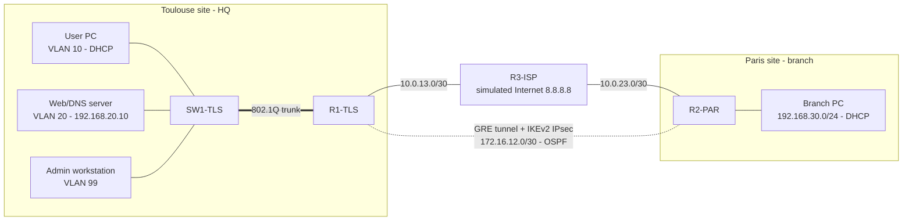

# 🌐 Secure Multi-Site Network Lab (Cisco)

A lab of an **enterprise network spread over two sites** (headquarters in Toulouse, branch office in Paris) connected by a **site-to-site IPsec VPN (IKEv2)**, with **VLAN segmentation**, **OSPF routing**, **DHCP**, **NAT** and **ACL filtering**.

The lab is designed for **GNS3** or **EVE-NG** using Cisco **IOSv** (routers) and **IOSvL2** (switch) images. All configurations are in [`configs/`](configs), and the [test plan](docs/test-plan.md) describes how to validate each feature.

## 🚧 Project status
- [x] Toulouse site: VLANs, 802.1Q trunk, router-on-a-stick, DHCP, users ACL, NAT, SSH hardening
- [x] Simulated ISP
- [ ] Paris branch router and IKEv2 IPsec tunnel to HQ
- [ ] OSPF over the tunnel
- [ ] Test plan and captured results

## 🗺️ Topology

## 📋 Addressing plan

| Network | VLAN | Subnet | Gateway | Purpose |
|---|---|---|---|---|
| Toulouse users | 10 | 192.168.10.0/24 | 192.168.10.1 | Workstations, DHCP (.21 to .254) |
| Toulouse servers | 20 | 192.168.20.0/24 | 192.168.20.1 | Web/DNS server 192.168.20.10 |
| Management | 99 | 192.168.99.0/24 | 192.168.99.1 | Device management (SW1: .2) |
| Paris LAN | – | 192.168.30.0/24 | 192.168.30.1 | Branch workstations, DHCP |
| Toulouse WAN | – | 10.0.13.0/30 | 10.0.13.2 | R1 ↔ ISP link |
| Paris WAN | – | 10.0.23.0/30 | 10.0.23.2 | R2 ↔ ISP link |
| Inter-site tunnel | – | 172.16.12.0/30 | – | IPsec-encrypted GRE |
| Loopbacks | – | 1.1.1.1, 2.2.2.2 | – | OSPF router IDs |

## 🔐 What the lab demonstrates

| Feature | Implementation |
|---|---|
| **Segmentation** | 3 VLANs on SW1, 802.1Q trunk with an unused native VLAN (999), unused ports shut down |
| **Inter-VLAN routing** | Router-on-a-stick on R1 (dot1Q subinterfaces) |
| **DHCP** | Pools on R1 (VLAN 10) and R2 (Paris LAN), with excluded ranges |
| **Site-to-site VPN** | GRE tunnel protected by IPsec: IKEv2, AES-256, SHA-256, DH group 14 |
| **Dynamic routing** | OSPF area 0 only through the tunnel, MD5 authentication, passive interfaces by default |
| **ISP isolation** | R3 knows none of the private networks: sites can only talk through the encrypted tunnel |
| **NAT / PAT** | "Internet" access (8.8.8.8) for the LANs, without translating inter-site traffic |
| **Filtering** | `USERS-IN` ACL: users reach servers only over HTTP/HTTPS/DNS/ping and have no access to the management VLAN |
| **Hardening** | SSH v2 only, ACL on VTY lines, port security, BPDU Guard, encrypted passwords |

## 🚀 Deploying the lab

1. In GNS3 / EVE-NG, build the topology above with 3 **IOSv** routers, 1 **IOSvL2** switch and **VPCS** hosts.
2. Cabling:
   - R1 Gi0/0 ↔ SW1 Gi0/0 · R1 Gi0/1 ↔ R3 Gi0/0
   - R2 Gi0/1 ↔ R3 Gi0/1 · R2 Gi0/0 ↔ branch PC
   - SW1 Gi0/1 ↔ user PC · Gi0/2 ↔ server · Gi0/3 ↔ admin workstation
3. Paste each file from [`configs/`](configs) in `configure terminal` mode, **after replacing the `CHANGE_ME_*` values** (passwords, IPsec pre-shared key, OSPF key).
4. Save: `copy running-config startup-config`.
5. Run through the [test plan](docs/test-plan.md).

## 🧪 Results

Command outputs and screenshots from the tests go in [`docs/captures/`](docs/captures): OSPF adjacency over the tunnel, active IPsec SAs with encrypted packet counters, DHCP leases, NAT translations and ACL hit counters.

## 🔭 Next steps
- Replace the pre-shared key with **certificates** (PKI)
- Add a **second ISP** and **VPN redundancy**
- Automate configuration deployment with **Ansible** (`cisco.ios`)
- Send ACL and IPsec logs to a **Syslog server**

## 👩‍💻 Author
**Aya Ltifi**, Systems, Networks & Telecommunications engineering student (Toulouse, France) · [LinkedIn](https://www.linkedin.com/in/ltifi-aya-b290762b5/)
